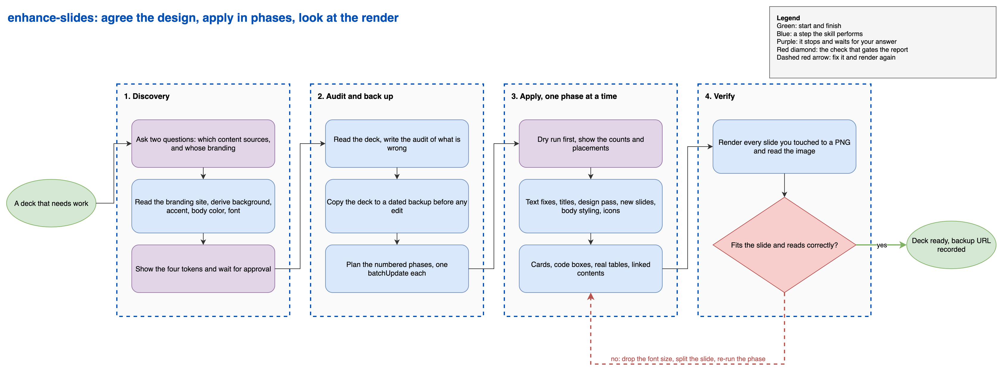

# Google Slides deck skill for Claude Code

A Claude Code skill that takes a rough Google Slides deck and turns it into one that holds together: a single design system pulled from a brand you point it at, real card layouts instead of paragraph dumps, per-slide icons, real tables, and a linked contents page. It renders every slide it touches to a PNG and looks at the image before calling the slide done.

The problem it solves is narrow. Asking a coding agent to fix a deck usually gets you either advice you have to carry out by hand, or a pile of API calls fired blind. Nothing in a `batchUpdate` response tells you the body text ran off the bottom of the slide. This skill pairs the API work with a render-and-look step, and runs the whole thing in phases so a failure at slide 40 does not undo the first 39.

## How it runs



Source: [docs/enhance-slides-flow.drawio](docs/enhance-slides-flow.drawio) (editable in draw.io).

## What is in here

- **`enhance-slides/SKILL.md`** the skill itself. Runs the discovery questions, audits the deck, plans the phases, drives the script, verifies by rendering.
- **`enhance-slides/script_template.py`** a runnable phased template. Fill in the constants block at the top, then run one phase at a time. It carries the request builders for backgrounds, title and body styling, new slides, icons, cards, code boxes, captions, and a linked table of contents.
- **`enhance-slides/icons.md`** Icons8 slugs sorted by whether they survived the Slides image fetcher end to end, plus a content-type to slug mapping and the URL format.

## Install

**On Windows:** install [Git for Windows](https://git-scm.com/downloads/win), so Claude Code runs these scripts in Git Bash. Where a command here says `python3` and your PC has only `python`, use `python`. In WSL, follow the Linux steps.

Copy the skill directory into your `~/.claude/skills/` so Claude Code picks it up:

```bash
cp -R google-slides-skill/enhance-slides ~/.claude/skills/
```

Then install the Google client libraries:

```bash
pip install google-api-python-client google-auth-httplib2 google-auth-oauthlib
```

## Google credentials

The skill edits decks through the Slides API, which needs a Google OAuth client of your own. One-time setup:

1. Open [the Google Cloud credentials console](https://console.cloud.google.com/apis/credentials) and pick or create a project.
2. Enable the Google Slides API on that project.
3. Create an OAuth 2.0 Client ID of type **Desktop app**.
4. Download the JSON to `~/.claude/google-oauth/credentials.json`.

The first run opens a browser for consent and caches the token at `~/.claude/google-oauth/slides_token.json`. The requested scope is `.../auth/presentations` and nothing wider, so the credential can edit presentations and cannot read the rest of your Drive.

If the cached token is ever revoked, the script says so and re-runs consent instead of failing with a refresh error.

## What it actually does

It starts by asking you two things, and waits for the answers before touching the deck:

1. **Which sources should new content come from?** URLs, file paths, or document IDs. It reads each one, audits the deck against it, and proposes slides and edits for you to approve before anything is applied. Answer "none" to get design and cleanup only.
2. **Whose branding should the design follow?** A company URL, a brand-guidelines page, the built-in default, or your own hex codes and font. From a URL it pulls a background, an accent, a body color, and a font family, then shows you the four tokens it derived and waits for you to confirm or correct them.

After that it backs up the deck to a dated copy, writes an audit of what is wrong with it, and works through numbered phases: text fixes, missing titles, the visual pass, new slides, body styling, icons, then anything sourced from your articles. Each phase is its own `batchUpdate`.

The phases are idempotent. Re-running skips slides that already have a title, an icon, or the exact slide title being inserted, so an interrupted run picks up where it stopped rather than duplicating work.

## The part that earns its keep

Cleanup and re-skinning is the floor. The skill also rewrites body slides so they look like slides:

- Comparisons, parallel items, and N-part models become rounded-rectangle cards (columns, an X against Y split, or a 2x2 grid) with a takeaway caption underneath.
- Code and config go in a monospace box on a light fill.
- Tab-separated text that was pretending to be a table becomes a real Slides table.
- Decks past roughly 30 to 40 slides get a Contents slide whose entries link by `pageObjectId`, so the links survive a later reorder.

Every slide it builds or edits gets rendered to a PNG through `pages().getThumbnail` and inspected for text running off the bottom, ragged columns, and overlapping elements. That check is the reason the card layouts are safe to use at all.

## Failure modes it already knows about

`SKILL.md` carries a table of the traps that cost real time, so you do not rediscover them:

- One bad request rolls back a whole 100-request batch, which is why phases are separate and icons are sent one at a time.
- A `replaceAllText` whose replacement contains the search string mutates itself on the next run.
- An Icons8 slug can return 200 from curl and still fail inside the Slides fetcher. The template retries three times and prints the API message, because "image not found" and "problem retrieving" need opposite fixes.
- `&#9;` and `&#11;` in a Drive text export are real tabs and soft line breaks that render correctly. Stripping them destroys the author's line breaks.
- A rounded rectangle centers its text by default, so multi-line card bodies come out ragged unless the paragraph alignment is set.

## Optional companions (not bundled)

- **A Drive MCP server** is what the backup step uses (`copy_file`), along with `read_file_content` for the initial audit. Without one, back the deck up by hand with File > Make a copy before letting the skill edit anything. The editing path does not depend on it.
- **Icons8** serves the per-slide icons over the network at run time. Nothing is vendored here.

## Model routing

The skill pins a Claude Code model alias in its frontmatter. Deck work is execution and content work, so it pins `model: opus`.

If that model is not on your plan, or you prefer different routing, edit the `model:` line in `enhance-slides/SKILL.md`, or delete it to inherit your session model.

## Conventions

- The skill never edits a deck it has not backed up, and never deletes a slide without you saying so.
- The design system is derived per run and confirmed with you. The built-in palette is a fallback you have to ask for, not a default it applies quietly.
- Slide copy is held to the same bar as the rest of the deck: no AI-tell vocabulary, no em dashes, no Unicode box-drawing characters.

## License

MIT. See [LICENSE](LICENSE).
